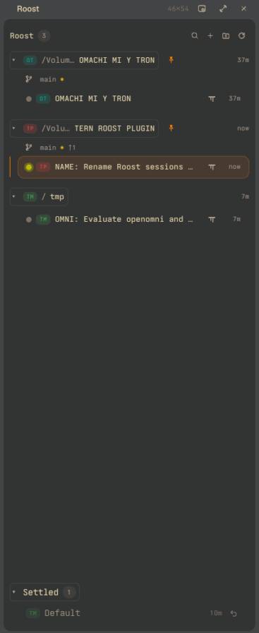

# Roost

**All your Tern sessions in one panel, and all your agents' work on one board.**

You have agents running in a dozen sessions, across several projects, maybe on two machines. Roost gives you two views that keep it under control:

- **The Roost panel** sits on the left and lists every session, grouped by folder. One look tells you which agent is working, which one is waiting for you, and which session you last touched.
- **Mission control** is a Kanban board of your agents' tasks. It shows what needs your answer, what's queued, running and done. Click any card to read the thread and answer it without leaving Tern.



## Install in one line

```sh
/Applications/Tern.app/Contents/MacOS/tern plugin install github.com/roverdude24/tern-roost
```

Then press **`⌘⌥⇧L`** to show the panel.

You need [Tern](https://docs.stencil.so/tern/) on macOS. That's it: no git, no repository, no setup. Mission control also needs a task board (see [Mission control](#mission-control)).

## The Roost panel

### See every session at a glance

Sessions are grouped by the folder they run in, so each project's work sits together. Each row tells you:

- **What it's doing:** a pulsing green dot while an agent works, blue when it's waiting for you, grey when idle.
- **Which agent runs it:** omp, Claude Code, Codex, Pi, Hermes, Gemini, OpenCode or Aider, shown as an icon.
- **When you last used it:** `now`, `12m`, `4h`, `2d`.

Sessions waiting for you rise to the top of their folder. If Tern is in the background, macOS sends an alert when an agent finishes, fails or needs you.

### Names that write themselves

A new session takes the title its agent gives itself. Start omp on a task and the session becomes `OMNI: Evaluate repos`, in the panel and in Tern's tab bar. Rename it yourself and Roost leaves your name alone.

### Jump around fast

- **`⌥J` / `⌥K`:** next or previous session.
- **`⌥⇧1`–`⌥⇧9`:** jump straight to a session.
- **Find session** in the header searches every session by name.
- Hover a folder for one-click **new session**, **new omp session**, **Finder** and **pin**.

### Your order, your way

Pin the folders you use most, so they always stay at the top. To reorder, right-click a folder or session, choose **Move**, then click where it should go.

### Git, when you want it

When a folder is a git repository, Roost adds a few small marks: the branch, an amber `●` for uncommitted changes, `↑`/`↓` for commits to push or pull, and the PR number (if `gh` is installed). Worktrees appear under their repository, and you can create or remove one from the right-click menu. Folders that aren't repositories work the same as always.

### Works across machines

Connected to another computer with `tern remote`? Its sessions show up in the same panel, each labelled with its host. Click a remote session to switch to it, or start a new session on any host.

### Settled: a shelf, not a trash can

Done with a session? **Settle** it. It closes, and Roost remembers its folder, name and agent. Click **↶** later to bring it back exactly as it was. Sessions that end on their own land here too, so nothing gets lost.

## Mission control


Your agents post tasks to a board ([Vercel Board](https://vercel.com), the `vb` CLI). Mission control turns that board into a Kanban inside Tern. Open it with the list icon in the Roost header.

### What needs you comes first

| Column | What's in it |
| --- | --- |
| 🔴 **Needs you** | decisions waiting for your answer, blocked and failed tasks |
| 🟡 **Todo** | ready to be picked up |
| 🟡 **Working** | an agent is on it |
| 🟡 **Waiting** | waiting on another task |
| 🟢 **Done** | the latest finished work |

Each card has a coloured status pill, so you can scan the whole board in seconds.

### One project or all of them

Chips above the board list your projects, the busiest first, each with its count of open tasks and tasks that need you. Click **All** to see everything at once, with every card tagged by project. Click one project to focus on it. The board scales from one project to dozens.

### Answer without switching apps


Click a card and a panel opens beside the board with the full conversation. From there you can:

- **Reply**, or answer a decision with one click (**A** / **B**)
- **Unblock** a stuck task, or **Reopen** a failed one
- **Cancel** a task (Roost asks for a reason first)
- Open the thread as a note

**New goal** sends a goal to a project. Your lead agent breaks it into tasks, and they appear on the board.

The board refreshes every 30 seconds by itself, and the header shows when it last did.

*Screenshots use made-up projects and tasks.*

### Setup

Mission control needs Node.js and a Board checkout at `~/Developer/vinhlam-board` with `npm install` done, linked to your board. If your checkout lives somewhere else, Mission control asks you to choose the folder. Each project is a `<name>/build` channel on the board; decisions go in `<name>/decisions`.

## Cheat sheet

| Where | What you can do |
| --- | --- |
| Keys | `⌘⌥⇧L` show or hide the panel, `⌥J` / `⌥K` next / previous session, `⌥⇧1`–`⌥⇧9` session 1–9 |
| Header | Mission control, Find session, New session, Add folder, Refresh |
| Folder (hover) | pin, `+` new session, ✦ new omp session, Finder |
| Folder (right-click) | New session, New omp session, Reveal in Finder, Pin or Unpin, Move, New worktree session, Remove worktree |
| Session (right-click) | Rename, Move, New tab here, Lock or Unlock, Settle, Close |
| Settled (right-click) | Restore, Forget |
| Palette | type *Roost* for show or hide, Find, New session in folder, Rename, Mission control, Next / Previous, Session 1–9 |

## Good to know

- **Overseer:** Roost installs next to [Overseer](https://github.com/mmnavarr/overseer), but the two panels share one left column, so show one at a time.
- **Run from source:** clone the repo and run `tern plugin link "$PWD"`. Roost reloads whenever you save a file.
- **Your data stays local:** pins, order, panel width, activity times and Settled are kept in Tern's plugin store on your Mac.
- **Credits:** forked from [mmnavarr/overseer](https://github.com/mmnavarr/overseer) (MIT, see `LICENSE`). The panel mechanics come from Overseer; folders, hosts, Settled and Mission control are new.
