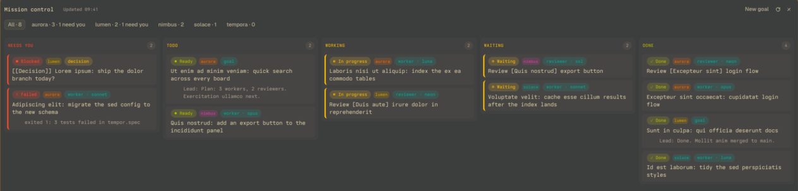
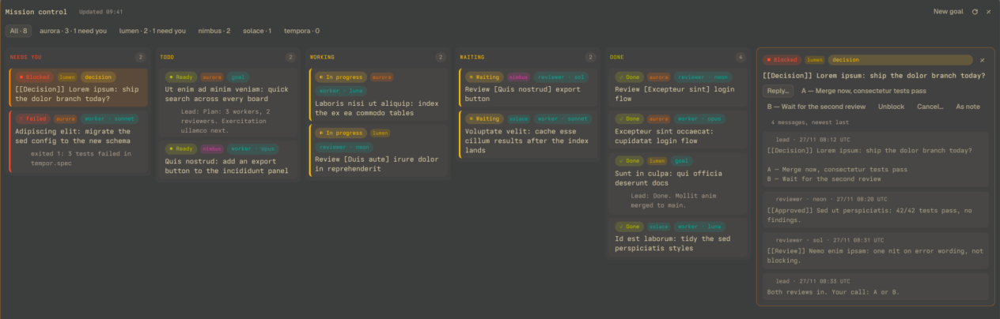

# Roost

A Tern plugin with two parts:

- **Roost panel:** a left panel listing every Tern session, grouped by working folder, on every connected host. Each row shows its agent harness, its state and how long since it was last active. Folders that are git repositories also show their branch and worktrees. A Settled shelf keeps the sessions you are done with. Any folder works; nothing needs a repository.
- **Mission control:** a Kanban tab over an agent task board ([Vercel Board](https://vercel.com), the `vb` CLI). It shows what needs you, what is queued, running, waiting and done, for one project or all of them. Click a card to read its thread and act on it.






The Mission control screenshots use made-up projects and tasks.

Forked from [mmnavarr/overseer](https://github.com/mmnavarr/overseer) (MIT, see `LICENSE`). The panel mechanics come from Overseer; the folder model, hosts and Mission control are new.

## Install

You need the [Tern](https://docs.stencil.so/tern/) desktop app on macOS. Git is optional. Mission control also needs Node.js and a Board checkout (see [Mission control](#mission-control)).

```sh
/Applications/Tern.app/Contents/MacOS/tern plugin install github.com/roverdude24/tern-roost
```

To run it from source instead, clone the repo and run `tern plugin link "$PWD"`. It reloads whenever a file changes.

Roost can be installed next to Overseer; each has its own shortcut (Overseer uses `⌘⌥⇧P`). If both panels are open, they share one left column, so show one at a time.

## Roost panel

Show or hide the panel with `⌘⌥⇧L`, the palette command *Show or hide Roost*, or its status-line segment. The panel follows whichever tab is shown and remembers its width.

**Folders.** A session belongs to the working directory of its first tab, or of the next tab when the first has none.
- Each folder gets a two-letter badge in a colour fixed by its path: the first letters of its first and last words, or the first two letters of a one-word name.
- Pinned folders always show, at the top, in the order you pinned them. The rest follow by session count, then name. Directories Roost cannot place go under *Other*.
- A session inside a pinned folder, a repository or a worktree is listed under the deepest of those that holds it, with its subfolder shown dimmed.
- Hover a folder header for its buttons: `+` (new session), ✦ (new omp session), Finder, and pin.

**Rows.** Each session row shows:
- a status dot: grey when idle, pulsing green while an agent works, blue while one waits for you
- the session name
- a harness icon: omp, Claude Code, Codex, Pi, Hermes, Gemini, OpenCode or Aider, else a terminal
- time since it was last active: `now`, `12m`, `4h`, `2d`

Hover a row to see its folder, host, harness and model. Within a folder, sessions whose agent waits for you come first, then the most recently active. When the panel is narrow, the folder path and then the harness icon are hidden first, so names stay readable.

**Names.** A session still named after its folder (the default name for a new one) takes the title its agent sets, minus the leading icon. So omp's `OMNI: Evaluate repos` becomes the session's name, in the panel and in Tern's tab bar. The name follows the agent as it retitles. Rename a session yourself, in Roost or Tern, and Roost leaves your name alone.

**Order.** Tern panels take clicks, not drags, so moving works in two clicks:
1. Right-click a folder or session and choose *Move* to pick it up.
2. Click the folder or session whose place it should take. Click the picked item again to cancel.

Sessions move only within their own folder. Your order is kept, and new folders and sessions appear above it.

**Hosts.** Roost lists sessions on every machine Tern is connected to (`tern remote`).
- A remote folder shows its host (`vinhlam-pc:C:\Users\me\` **tmp**), so the same path on two machines stays two folders.
- Once sessions from two hosts appear, each row names its host. Click a remote row to switch to it.
- *New session* asks for the host first (when more than one is connected), then offers that host's folders, *Type a path…* and, on this Mac, *Choose folder…*. Roost switches to that host and opens the session there. A remote folder's `+`, ✦ and *New session here* open on its own host too.
- The panel follows you onto a remote host; each host keeps its own copy. If Tern cannot open it there, the shortcut tells you why.
- Finder, pins and git marks work on this Mac only. Auto-naming works on every host.

**Git.** When a folder is a git repository, its header shows small marks:
- the branch, when it is not `main` or `master`
- an amber `●` for uncommitted changes
- `↑`/`↓` for commits ahead of or behind its upstream
- the pull request number, if `gh` is installed and finds one

Hover the header to read them in words. Linked worktrees appear under their repository. Folders that are not repositories show none of this.

**Settled.** The collapsed *Settled* section at the bottom keeps sessions you are done with: name, folder, harness, model, host and last activity, newest first, up to 200.
- *Settle* in a row's menu closes the session's programs, after asking you to confirm. A session that ends any other way lands here too.
- Idle sessions are never settled automatically.
- `↶` (on hover, or right-click › *Restore*) reopens a session with the same folder and name, running the same harness when Roost knows it. A remote session reopens on its own host.
- Right-click › *Forget* removes it from the list.

**Activity.** Tern gives sessions no timestamps, so Roost records one whenever you focus a session, a command starts or finishes, an agent changes state, or a title or directory changes. Sessions older than Roost start from how long `tern inspect` says they have been quiet.

**Alerts.** While Tern is in the background, macOS shows an alert when an agent finishes, fails or needs your input.

## Mission control

Open Mission control with the list icon in the Roost header or the palette command *Roost: Show or hide Mission control*. It opens as a tab. The same icon, lit while the tab is open, closes it again, as does the ✕ in the tab.

**Board.** Five columns, each with a count:

| Column | Holds |
| --- | --- |
| Needs you | decisions waiting for an answer, blocked and failed tasks |
| Todo | tasks ready to be picked up |
| Working | tasks an agent has claimed |
| Waiting | tasks waiting on another task |
| Done | the latest finished tasks, newest first (12 shown) |

Each card shows its state as a coloured pill (red for Failed and Blocked, yellow for Waiting, In progress and Todo, green for Ready and Done) and its kind and lane in a cyan pill. A goal also shows the lead's latest note. Cards that need attention have a red or yellow edge.

**Projects.** A row of project chips sits above the board. Each chip shows the project's open tasks and how many need you, with the projects that most need you first.
- *All* shows every project. Each card then carries a coloured tag with its project's name.
- Clicking a project chip shows only that project. Mission control remembers the choice, and reading one project is faster than reading all.

**Card panel.** Click a card to open its panel beside the board. The panel shows the task's whole thread, oldest message first, with author and time. Its actions:

| Action | When | What it does |
| --- | --- | --- |
| *Reply…* | always | writes a reply in the thread |
| A / B answers | a decision lists options | replies with that option |
| *Unblock* | blocked | lifts the hold, so the task is ready again |
| *Reopen* | failed | makes the task ready again |
| *Cancel…* | not finished | cancels the task, after asking for a reason |
| *As note* | always | opens the thread as a Tern note |

Click the card again or the panel's ✕ to close it.

**New goal.** *New goal* asks for a project (the one on show is offered first) and the goal text, then posts the goal to that project's `<project>/build` channel. The Board's lead agent splits it into tasks.

**Refresh.** The tab refreshes every 30 seconds while it is open, and the header shows the time of the last refresh. The refresh button does it right away.

**Setup.** Mission control runs the Board CLI through Node.js (`/opt/homebrew/bin`, `/usr/local/bin` or `/usr/bin`). It expects a Board checkout at `~/Developer/vinhlam-board` with `npm install` done, linked to your board. If yours lives elsewhere, use *Choose Board folder*, shown when Mission control cannot find it. Projects are the Board's `<name>/build` channels; decisions live in `<name>/decisions`.

## Reference

| Where | Action |
| --- | --- |
| Header icons | Mission control, Find session, New session, Add folder (pin), Refresh |
| Folder (hover) | pin, `+` new session, ✦ new omp session, open in Finder |
| Folder (right-click) | New session, New omp session, Reveal in Finder, Pin or Unpin, Move, New worktree session (repositories), Remove worktree (worktrees) |
| Session (right-click) | Rename, Move, New tab here, Lock or Unlock, Settle, Close |
| Settled row (right-click) | Restore, Forget |
| Palette | Show or hide Roost, Roost: Find session, Roost: New session in folder, Roost: Rename current session, Roost: Show or hide Mission control, Roost: Next / Previous session, Roost: Session 1–9 |
| Keys | `⌘⌥⇧L` show or hide, `⌥J` / `⌥K` next / previous session, `⌥⇧1`–`⌥⇧9` session 1–9 (panel order) |

*New worktree session* asks for a branch name, runs `git worktree add` into a sibling folder (`<repo>-<branch>`) and opens a session there. *Remove worktree* refuses while the worktree has uncommitted changes or a session is open in it. It always keeps the branch.

New tabs follow Settings › New tabs and splits open (shell or agent), like ⌘T.

Roost keeps everything in the plugin's own key-value store: pinned folders, collapsed folders, your order, panel width, activity times, Settled, and Mission control's Board folder and project filter.
