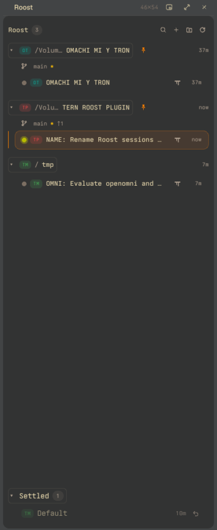

# Roost

A Tern plugin: a left panel where every session roosts, grouped by working folder. Folder badges, the agent harness each session runs, how long since it was last active, git branches and worktrees when a folder is a repository, and a Settled shelf for sessions you are done with. Any folder works; nothing needs a repository.



Forked from [mmnavarr/overseer](https://github.com/mmnavarr/overseer) (MIT, see `LICENSE`); the panel mechanics are Overseer's, the folder model is new.

## Install

Needs the [Tern](https://docs.stencil.so/tern/) desktop app on macOS. Git is optional.

```sh
/Applications/Tern.app/Contents/MacOS/tern plugin install github.com/roverdude24/tern-roost
```

Or clone it and `tern plugin link "$PWD"` to run it from source (it reloads when files change).

Installs alongside Overseer with its own shortcut (Overseer is `⌘⌥⇧P`), but both panels open at once split one left column between them; show one at a time.

## Use

Show or hide with `⌘⌥⇧L`, the palette command *Show or hide Roost*, or the status-line segment. The panel follows the shown tab and remembers its width.

**Folders.** A session lives under the working directory of its first tab (the next tab when the first has none). Each folder has a two-letter badge (first letter of its first and last word, or the first two letters of a single word) in a colour fixed by its path. Unknown directories go under *Other*. Pinned folders always show, first, in the order pinned; a session inside a pinned folder, a repository or a worktree is listed under the deepest one holding it, with the subfolder dimmed beneath. The rest follow by session count, then name. A folder's +, omp, Finder and pin buttons appear when you hover its header.

**Rows.** Dot (grey idle, green pulsing while an agent works, blue while one waits for you), name, a harness icon (omp, Claude Code, Codex, Pi, Hermes, Gemini, OpenCode, Aider, else a terminal) and the time since the session was last active (`now`, `12m`, `4h`, `2d`, `31d`). Hover a row for its folder, host machine, harness and model. Within a folder the most recently active session comes first. In a narrow panel the folder path, then the harness icon give way so names stay readable; folder names end in `…` when they still don't fit.

**Names.** A session still named after its folder (the name Tern and Roost give a new one) takes the title its agent sets, minus the leading icon, so omp's `OMNI: Evaluate openomni and omniget repos` becomes the session's name, in the panel and in Tern's tab bar alike. It follows the title as the agent retitles. Rename a session yourself (in Roost or Tern) and Roost leaves that name alone.

**Activity.** Tern gives no timestamps, so Roost stamps a session whenever a command starts or finishes, an agent changes state, a title or directory changes, or you focus it. Sessions that predate Roost start from how long `tern inspect` says they have been quiet. Stamps are saved in the plugin's store.

**Git.** When a folder is a git repository its header shows the branch, `✱` for uncommitted changes, `↑`/`↓` against its upstream, and the pull request number if `gh` is installed and finds one. Linked worktrees nest under their repository. Non-repositories look exactly as before.

**Settled.** A collapsed *Settled* section at the bottom keeps sessions you are done with: name, folder, harness, model, host and last activity (newest first, up to 200). *Settle* in a row's menu closes its programs after confirming; any session that ends some other way lands there too. Idle sessions are never settled automatically. `↶` (on hover, or right-click › Restore) reopens a session in the same folder with the same name, running the same harness when known; right-click › Forget drops it.

| Where | Action |
| --- | --- |
| Header icons | Find session, New session (pick a pinned or in-use folder, or browse), Add folder (pin), Refresh |
| Folder (hover) | pin, `+` new session, ✦ new session running `omp`, open in Finder |
| Folder (right-click) | New session, New omp session, Reveal in Finder, Pin or Unpin, New worktree session (repositories), Remove worktree (worktrees) |
| Session (right-click) | Rename, New tab here, Lock or Unlock, Settle, Close |
| Palette | Show or hide Roost, Roost: Find session, Roost: New session in folder, Roost: Rename current session |

*New worktree session* asks for a branch name, runs `git worktree add` into a sibling folder (`<repo>-<branch>`) and opens a session there. *Remove worktree* refuses while the worktree has uncommitted changes or a session is open in it, and always keeps the branch.

New tabs follow Settings › New tabs and splits open (shell or agent), like ⌘T.

Pinned folders, collapsed state, panel width, activity and Settled live in the plugin's key-value store.
